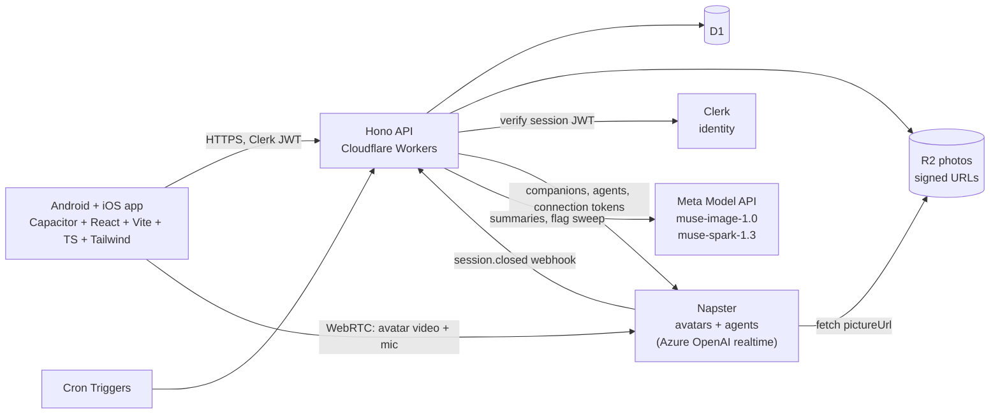

# EverThere

> **Be there, even when you can't.**

EverThere is an Android app that lets a parent comfort their young child from anywhere. A parent turns their own photo into a live, talking avatar on Napster, then teaches it how they comfort their child: nicknames, tone, favorite things, a song, and topics to avoid. When the child is upset at daycare or with a nanny, the caregiver opens a short live call with "Mommy" or "Daddy" on the screen. Afterward the parent gets a summary, the mood before and after, and any moment that was flagged. Safety is designed in from the first line of the prompt.

Built for the Napster x Microsoft Azure Hackathon. **Try it in a browser:** https://everthere-web.m-vamshikrishna22.workers.dev (or install the [Android APK](https://github.com/mallelavamshi/everthere-app/releases/latest)). **Live API:** https://everthere-api.m-vamshikrishna22.workers.dev

**Judges: start at [`docs/submission/judges.md`](docs/submission/judges.md).** It has the APK link and a two-minute tour. Written summary: [`docs/submission/summary.md`](docs/submission/summary.md). Demo video: [YouTube](https://www.youtube.com/watch?v=HwNKQCOXtLM). Video storyboard: [`docs/submission/demo-script.md`](docs/submission/demo-script.md).

## The problem

Separation distress is one of the hardest parts of early childcare. A toddler cries at nap time, the teacher can't reach a parent who is in a meeting, and the parent hears about it hours later, if at all. Phone calls interrupt work and aren't always possible. EverThere gives the caregiver a calm, familiar face and voice right now, and gives the parent a clear picture afterward.

## How it works

| Who | What they do |
| --- | --- |
| **Parent** | Signs up, makes an avatar from a photo, picks a voice, gives consent, and writes a comfort plan per child (names, tone, favorites, phrases, a song, "never talk about", a Today note). Runs a **test call**, then **approves** the avatar. Invites caregivers, decides who may read transcripts, and reads sessions, summaries and alerts. |
| **Caregiver** (teacher or nanny) | Sees the roster, picks a child and a reason (Missing Mommy, Upset at nap, New and nervous, Got a boo-boo), and runs a live call with the caregiver always present. Can tap "Our song" to have the avatar sing the parent's saved song. Ends the call with a check-in: Calmer, Same, or Still upset, plus a note. Teachers can share a classroom tablet and switch with a 4-digit PIN. |
| **Daycare admin** | Sets up the daycare, classrooms and staff, enrolls children (which creates parent invites), and sees today's sessions and open flags. |

No child call can start until a parent has completed a test call and approved the avatar.

## Architecture



One app (Android, iOS and the web, from the same code) whose home screen depends on who signs in. One Hono API on Cloudflare Workers with D1 for data, R2 for photos and Cron Triggers for sweeps (every 2 minutes) and the nightly demo reset (08:00 UTC). Roles live in D1 and every permission is enforced on the server, not just hidden in the UI.

## How Napster is used

| Napster feature | How EverThere uses it |
| --- | --- |
| **Companions from a photo** | A parent's photo (kept in private R2, served through a short-lived signed URL) becomes a Napster companion, using v1 photo mode. |
| **Agents with locked instructions** | Each parent avatar is a Napster agent in `conversation` mode. The Worker builds the system prompt. The instructions teach a child-comfort method (connect, name the feeling, breathe, redirect, hand back to the grown-up) and end with locked safety rules that always win over anything else the agent is told. Parents never edit raw prompt text. |
| **Per-child memory** | Every session passes `externalClientId`, a hash of the child's id (first 32 characters of base64url SHA-256). Napster keys memory on companion plus client id, so each parent avatar remembers each child, and no raw id leaves the API. |
| **Implicit flag tool** | The agent has an implicit `flag_concern(category, quote, severity)` function. When the child says something like "I fell and hurt my knee", Napster delivers the call to the app, which shows a banner, posts the flag to the API (the parent is alerted at once), and returns the function output. |
| **Digital twin** | Mia's Daddy in the demo is the maker's own Napster digital twin: their real face and cloned voice, recorded with a self-consent record. Leaving `voiceId` out uses the twin's cloned voice. |
| **Per-call context** | Each connection carries an `externalClientProfile` (the child, why this call is happening, who is holding the screen, where the child is) and `initialSpeech` guidance, so the avatar opens on the reason for the call. |
| **FAQ collection and knowledge base** | Every agent is attached to an FAQ collection of 20 gentle answers to questions children ask ("When are you coming?") and a calm-corner knowledge base of breathing games and short stories (`pnpm napster:knowledge`). |
| **No idle timeout, camera off** | Agents set `disableIdleTimeout`, since a crying child may say nothing for a while. Every connection forces `videoPolicy: deferred`, so the child's camera is never sent. |
| **Webhooks** | Napster's `session.closed` webhook (signature verified, de-duplicated by event id) triggers the summary pipeline. A cron sweep covers a missed webhook. |
| **Transcripts and cost** | The Worker fetches the session transcript and cost from Napster after the call, for the summary and for the credit guard. |
| **Azure OpenAI realtime** | Napster's managed tier runs the conversation on Azure OpenAI realtime, so the live voice and reasoning come through Napster on Microsoft Azure. The voice is picked from the stock Azure OpenAI voices. |

## How Meta is used

| Model | Use |
| --- | --- |
| `muse-image-1.0` | All of the app's art (stickers, empty states, video cards) and the photorealistic, AI-generated demo portraits. Every demo face is synthetic and marked so, except Mia's Daddy: the maker's own Napster digital twin, recorded with a self-consent record. |
| `muse-spark-1.3` | After each session: a two-line summary, a mood signal, and a sweep for concerns the live tool missed. |

## Safety and privacy

- **Locked prompt rules:** no promises of times or events, no secrets, no scolding or shaming, no medical advice, never claim to be physically coming. If asked, the avatar says it is a video helper the parent made. Opening lines include "I'm here with you on the screen".
- **Flags, twice:** the live `flag_concern` tool, plus a post-call sweep. Sweep findings are checked against the child's own words, so quotes the avatar said itself are dropped.
- **A caregiver is always present.** A parent account cannot start a child session.
- **10-minute cap**, with a gentle warning at 8 minutes.
- **The child's camera is never sent.** Sessions send the microphone only.
- **Parent test call and approval before any child call.** Changing the photo or voice clears the approval.
- **Parent-controlled transcripts.** Parents always see their own child's. Daycare and home caregivers see summaries and flags, and full transcripts only if the parent switches that on.
- **Private photos:** R2 objects are never public, only short-lived signed links.
- **Credit guard:** a $120 total spend cap and a per-user daily limit (200 calls a day for shared demo users, 20 for everyone else).
- Release builds ship without source maps and with `allowBackup="false"`.

## Judge quick start

See **[`docs/submission/judges.md`](docs/submission/judges.md)** for the APK link, demo steps for both personas (Sarah Johnson, Mia's mom, as a Parent, and Ms. Jess Parker, Butterflies Room, Little Acorns Daycare, as a Teacher), a guided tour, and troubleshooting. On the Welcome screen tap **Try the demo**. No account needed.

## Build from source

**Prerequisites:** Node 20+, pnpm, a Cloudflare account with `wrangler` logged in, Android Studio with an Android SDK (a JDK comes with it), and accounts for Clerk, Napster and the Meta Model API.

**Environment variables** (names only; see `.env.example`, never commit values):

| Where | Names |
| --- | --- |
| Worker secrets (`wrangler secret put`) | `CLERK_SECRET_KEY`, `NAPSTER_API_KEY`, `NAPSTER_WEBHOOK_SECRET`, `META_API_KEY`, `MEDIA_SIGNING_KEY`, `ACTING_TOKEN_KEY`, `ADMIN_TOKEN` |
| Worker `[vars]` in `apps/api/wrangler.toml` | `PUBLIC_API_BASE`, `CLERK_AUTHORIZED_PARTIES`, `NAPSTER_FLAG_FUNCTION_ID`, `DEV_ROUTES` (keep `0` in production) |
| Mobile build | `VITE_API_BASE`, `VITE_CLERK_PUBLISHABLE_KEY` |
| Local scripts (`.env`) | the secrets above plus `API_BASE` |

**Commands:**

```bash
pnpm install

# Tests
pnpm --filter api test          # API
pnpm --filter mobile test       # mobile
pnpm test                       # everything

# Napster flag tool, then seed the demo world
pnpm napster:flag-tool
pnpm seed

# Deploy the API
cd apps/api
wrangler d1 migrations apply everthere --remote
wrangler deploy

# Android build (a production build fails on purpose if VITE_API_BASE is missing or local)
VITE_API_BASE=https://everthere-api.<account>.workers.dev pnpm --filter mobile build
pnpm --filter mobile cap:sync
# then build and sign the release APK in Android Studio (apps/mobile/android)

# iOS: no Mac needed. GitHub Actions (.github/workflows/ios.yml) builds an unsigned iOS Simulator app on every push
# to apps/mobile and smoke-tests it in a simulator. Download it from the run's artifacts; see docs/ios.md.
```

Full one-time setup (D1, R2, Clerk dashboard, Napster webhook, demo seed, smoke test) is in [`docs/notes/deploy-checklist.md`](docs/notes/deploy-checklist.md). Napster and Clerk behavior inside the Android WebView is documented in [`docs/notes/napster-events.md`](docs/notes/napster-events.md). The full design is in [`docs/superpowers/specs/2026-11-18-everthere-design.md`](docs/superpowers/specs/2026-11-18-everthere-design.md).

## Known limits and roadmap

| Limit today | Why / what's next |
| --- | --- |
| **Mostly stock voices** | Mia's Daddy uses the maker's own cloned voice through his Napster digital twin. The other demo parents use stock voices, and parents who sign up pick a stock voice: in-app voice cloning is on the roadmap (the Napster Recordings API wasn't enabled for preview clips). |
| **Softer lip-sync** | Avatars use Napster's v1 photo mode, so lip-sync is softer than v2 video avatars. |
| **No push notifications when the app is closed** | Alerts appear in the in-app Alerts center, and as local notifications while the app is open or resumes. Push is a roadmap item. |
| **Android app, plus the web and an iOS Simulator build** | The same app runs in any browser at the web link, built from the same code (`apps/mobile/wrangler.web.toml`). The iOS app compiles in CI and runs in the iOS Simulator, including in a browser through Appetize.io ([`docs/ios.md`](docs/ios.md)). Installing it on a real iPhone or through TestFlight needs a paid Apple Developer account to sign it. |
| **"Our song" isn't word for word** | The avatar is asked to sing or say the saved song, and the model may paraphrase it. |
| **Shared demo budget** | Demo use is capped so the shared account can't run out of credits. |

## Credits

Built with [Napster](https://napster.ai) live avatars and agents on Azure OpenAI realtime, the Meta Model API, Clerk, Cloudflare Workers, D1 and R2, Capacitor, React, Vite, Tailwind, Hono and Drizzle. Made for the Napster x Microsoft Azure Hackathon. Every face in the demo is AI-generated except Mia's Daddy, who is the maker's own Napster digital twin, used with their consent.
